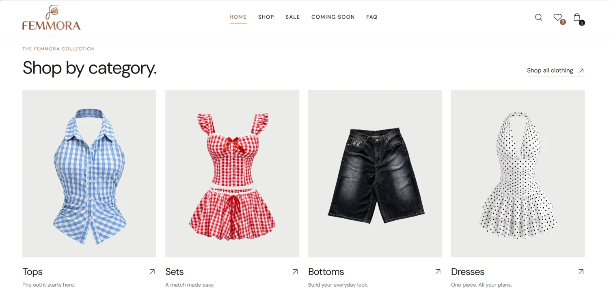
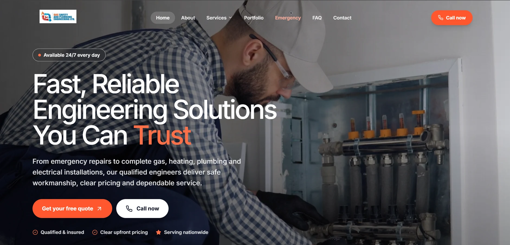
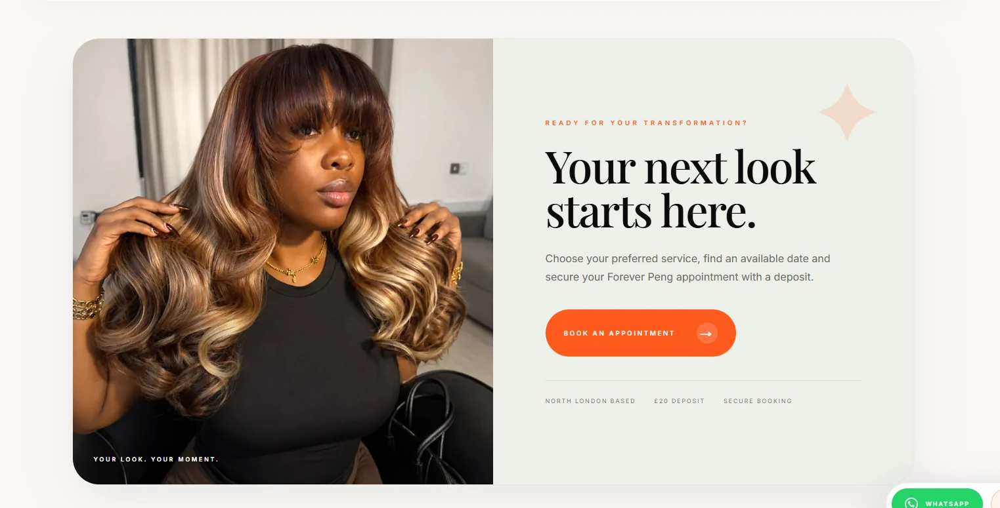
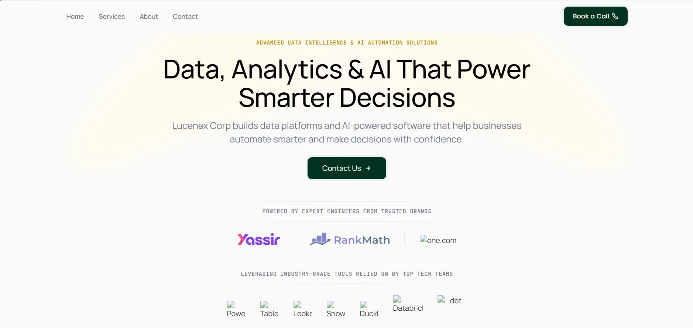
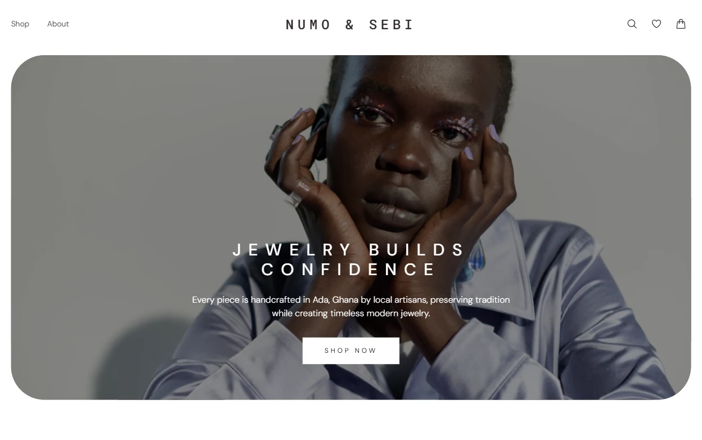

I'm a frontend developer based in Accra, Ghana. I build websites and product experiences that are clear, responsive, and useful in the real world — from booking flows and storefronts to internal dashboards.

I work mainly with React, Next.js, TypeScript, and Tailwind CSS. I'm also part of [MadeBySebi](https://madebysebi.com), where my brothers and I build digital products for businesses.

## Selected work

**[FEMMORA](https://femmora-gh.vercel.app/).** A responsive women's clothing storefront with a video-led homepage, collection browsing, product pages, and a shopping bag. [View the code](https://github.com/numoenochtetteh/femmora).

**[Gas Safety and Plumbing Engineering Ltd](https://gassafetyandplumbingengineeringltd.com/).** A responsive company website for gas, heating, plumbing, and electrical services. I built its service pages, portfolio, emergency page, FAQs, and contact flow. [View the code](https://github.com/numoenochtetteh/Gas-Safety-and-Plumbing-Engineering-Ltd-).

**[Forever Peng Hair](https://foreverpenghair.com/).** An online appointment booking platform for hair services. I built the multi-step booking flow, Stripe deposit payments, an admin approval process, and customer email and calendar confirmations.

**[Power Electrode Ltd](https://power-electrode-ltd.vercel.app/).** A company website presenting welding electrodes, manufacturing, and ways to get in touch. I built the responsive pages and gave the manufacturing process its own visual flow. [View the code](https://github.com/numoenochtetteh/power-electrode-ltd).

**[MadeBySebi](https://madebysebi.com/).** The studio I build with my brothers. Our site brings together our services, selected work, and a direct way for clients to start a project. [View the code](https://github.com/numoenochtetteh/madebysebi).

**[Lucenex Corp](https://www.lucenexcorp.com/).** A website for a data and AI company, presenting its data platforms, analytics, and AI software. My other Lucenex frontend work includes a [freight risk dashboard built on typed demo data](https://github.com/numoenochtetteh/dashboard).

**[Numo & Sebi Jewelry](https://jewelry-store-numo-sebi-58.vercel.app/).** An editorial storefront for handcrafted jewelry from Ada, Ghana, with a focus on imagery, product discovery, and a simple shopping experience. [View the code](https://github.com/numoenochtetteh/jewelry-store-numo-sebi).

Also: [ThyGraceMerch](https://thygracemerch.vercel.app/), a responsive shopping preview for a Ghanaian clothing brand.

## How I work

React and TypeScript for products. Once something works, most of my time goes into how it feels. That means thinking beyond one screen: the navigation, loading and error states, and the way each step leads to the next. Context changes what good design looks like. A booking flow has to be simple on a phone, with clear availability and deposit details; a clothing storefront has to make it easy to find the right category and see the products. I'll happily spend hours getting those details right.

## Elsewhere

[MadeBySebi](https://madebysebi.com/) · [LinkedIn](https://www.linkedin.com/in/enoch-numo-tetteh-993432358) · [Email](mailto:numoenochtettehkent@gmail.com)
