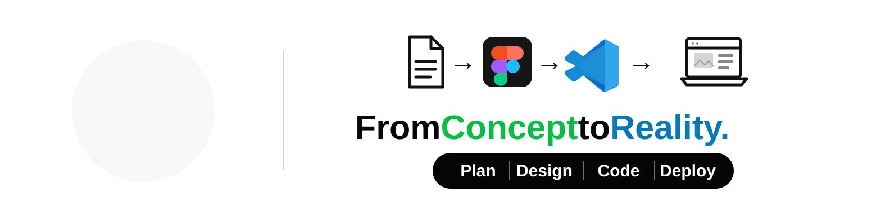

I'm a frontend developer based in Accra, Ghana. I build websites and product experiences that are clear, responsive, and useful in the real world — from booking flows and storefronts to internal dashboards.

I work mainly with React, Next.js, TypeScript, and Tailwind CSS. I'm also part of [MadeBySebi](https://madebysebi.com), where my brothers and I build digital products for businesses.

## Selected work

**[Forever Peng Hair](https://foreverpenghair.com).** An online appointment booking platform for a hair business. I built the multi-step booking flow, Stripe deposit payments, an admin approval process, and customer email and calendar confirmations. The screenshot shows a redacted view of the booking dashboard.

**[Power Electrode Ltd](https://power-electrode-ltd.vercel.app).** A company website presenting its products, manufacturing process, and ways to get in touch. I built the responsive pages and gave the manufacturing story its own visual flow. [View the code](https://github.com/numoenochtetteh/power-electrode-ltd).

**[MadeBySebi](https://madebysebi.com).** The studio I build with my brothers. Our site brings together our services, selected work, and a direct way for clients to start a project. [View the code](https://github.com/numoenochtetteh/madebysebi).

Other work includes the [Lucenex dashboard](https://github.com/numoenochtetteh/dashboard), a freight risk cockpit built on typed demo data, and the [ThyGraceMerch storefront](https://thygracemerch.vercel.app), a responsive shopping preview for a Ghanaian clothing brand.

## How I work

I start with what someone needs to do, then design and build the path around it. I pay close attention to mobile layouts, loading and error states, and the small details that make a product feel easy to use. For more involved projects, I test the important interactions with Playwright and Vitest before handing them over.

## Elsewhere

[MadeBySebi](https://madebysebi.com) · [LinkedIn](https://www.linkedin.com/in/enoch-numo-tetteh-993432358) · [Email](mailto:numoenochtettehkent@gmail.com)
